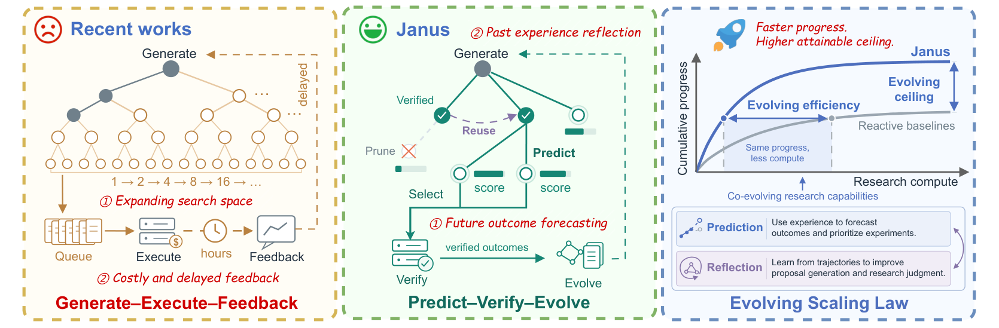
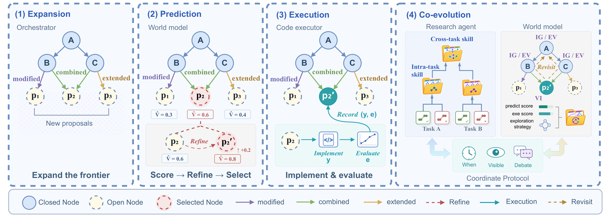

<p align="center">
  
</p>

# JANUS: Enhancing Long-Horizon Autonomous Research with Co-Evolving World Models

<p align="center"><b>Forecast future outcomes. Reflect on past experience. Co-evolve research capabilities.</b></p>

[](papers/JANUS.pdf)
[](#release-status)
[](#results)

Mengdi Liu<sup>1,2,*</sup>, Chenghao Jia<sup>1,2,*</sup>, Hong Chang<sup>1,2,†</sup>, Mingjie He<sup>1,2</sup>, Shiguang Shan<sup>1,2</sup>, Xilin Chen<sup>1,2</sup>

<sup>1</sup> State Key Laboratory of AI Safety, Institute of Computing Technology, CAS, China  
<sup>2</sup> University of Chinese Academy of Sciences (CAS), China

<sup>*</sup> Equal contribution. Mengdi Liu is the project leader.  
<sup>†</sup> Corresponding author: Hong Chang.

---

> [!NOTE]
> This repository hosts the JANUS paper and figures. Source code and reproduction scripts are not yet included. See [Release status](#release-status).

## Overview

**Long-horizon autonomous research is constrained by expanding search spaces and costly, delayed feedback.** In a conventional Generate–Execute–Feedback loop, each new hypothesis may require hours of training, simulation, or compilation before its value becomes clear. Reactive trial-and-error makes it difficult to allocate research compute effectively as the search frontier grows.

**JANUS unifies future outcome forecasting and past experience reflection through a Predict–Verify–Evolve loop.** An orchestrator expands an evolving research graph, while a world model forecasts the value of candidate proposals and selects, refines, or prunes them before execution. Ground-truth feedback then improves the skills of the research agent, the world model, and their coordination protocol.

**The goal is to improve both evolving efficiency and the attainable evolving ceiling:** make faster progress with a given research budget, and sustain improvement as additional compute becomes available.

<p align="center">
  
</p>

<p align="center"><a href="assets/Janus_Intro.pdf">View the overview figure as PDF</a></p>

## Highlights

- **An evolving research graph.** A directed acyclic graph records proposals, implementations, predictions, and execution evidence, supporting branch exploration, experience reuse, and performance attribution.
- **World-model-guided exploration.** Proposals are assessed by value improvement, information gain, and exploration utility. Sparse pairwise comparisons and adaptive priorities guide refinement, selection, and pruning before costly execution.
- **Experience-driven co-evolution.** Successful and failed trajectories become intra-task and cross-task research skills. The world model refines prediction and exploration skills, while a shared protocol improves when and how the agents coordinate.
- **Evaluation across research settings.** The paper evaluates JANUS on 30 MLS-Bench-Lite tasks across 12 domains, plus nanoGPT training optimization, MinGPT attention kernel optimization, and genotype-to-phenotype prediction.

## Method

<p align="center">
  
</p>

<p align="center"><a href="assets/method.pdf">View the method figure as PDF</a></p>

1. **Expand.** The orchestrator modifies, extends, or combines existing research nodes to propose new candidates.
2. **Predict.** The world model scores candidates, refines proposals through selective debate, and prioritizes experiments under the remaining budget.
3. **Verify.** The code executor implements the selected proposal, runs the experiment, and records its outcome in the research graph.
4. **Evolve.** Verified experience updates research skills, world-model judgment, exploration strategies, and coordination protocols for subsequent iterations.

## Results

The following results are reported in Table 1 of the [paper](papers/JANUS.pdf) on **MLS-Bench-Lite**. Each task uses a **5-hour wall-clock research budget and one NVIDIA A100 GPU**, under the evaluation protocol described in the paper. Higher is better for all metrics below.

| Method | Model | Valid Sub. | Beat Any | Beat Median | Beat All | Dev Score | Test Score |
|---|---|---:|---:|---:|---:|---:|---:|
| AutoResearch | DeepSeek-V4 Flash | 83.3% | 76.7% | 40.0% | 16.7% | 26.24 | 25.87 |
| AutoResearch | DeepSeek-V4 Pro | 90.0% | 83.3% | 46.7% | 16.7% | 27.01 | 27.13 |
| AIDE | DeepSeek-V4 Flash | 93.3% | 90.0% | 53.3% | 23.3% | 31.12 | 31.11 |
| MLEvolve | DeepSeek-V4 Flash | 96.7% | 93.3% | 56.7% | 30.0% | 33.89 | 32.99 |
| AIBuildAI | DeepSeek-V4 Flash | 90.0% | 86.7% | 60.0% | 33.3% | 34.95 | 35.14 |
| Arbor | DeepSeek-V4 Flash | 100.0% | 96.7% | 66.7% | 33.3% | 38.01 | 37.34 |
| Codex | DeepSeek-V4 Flash | 96.7% | 96.7% | 73.3% | 36.7% | 39.38 | 38.91 |
| Codex | GPT-5.6 Sol | 100.0% | 100.0% | 86.7% | 53.3% | 45.23 | 44.81 |
| JANUS | DeepSeek-V4 Flash | 100.0% | 100.0% | 76.7% | 43.3% | 41.99 | 41.07 |
| JANUS | GPT-5.6 Sol | 100.0% | 100.0% | 90.0% | 56.7% | 47.32 | 46.88 |
| **JANUS** | **Codex (GPT-5.6 Sol)** | **100.0%** | **100.0%** | **93.3%** | **63.3%** | **49.96** | **49.78** |

**Valid Sub.** measures valid submissions. **Beat Any / Median / All** measure the fraction of tasks outperforming at least one, the median-performing, or all provided human baselines. **Dev / Test Score** are mean normalized task scores. See the paper for full definitions, scaling analyses, ablations, and real-world research results.

## Release Status

| Item | Status |
|---|---|
| [Paper (PDF)](papers/JANUS.pdf) | Available in this repository |
| Overview and method figures | Available in PNG and PDF |
| Source code | Not yet released |
| Reproduction scripts and configurations | Not yet released |

## Citation

```bibtex
@misc{liu2026janus,
  title  = {{JANUS}: Enhancing Long-Horizon Autonomous Research with Co-Evolving World Models},
  author = {Mengdi Liu and Chenghao Jia and Hong Chang and Mingjie He and Shiguang Shan and Xilin Chen},
  year   = {2026},
  url    = {https://github.com/bilemond/JANUS}
}
```
